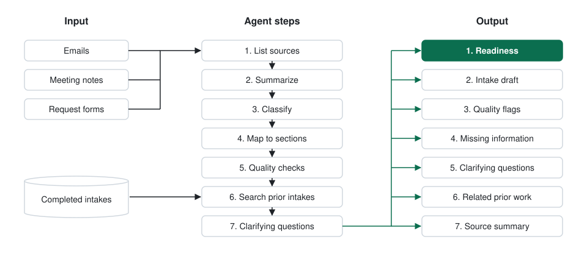

# Requirements Intake Agent

Agent instructions and configuration that turn rough project requests into a complete intake, so analysts can start requirements work without a round of follow-up questions.

[](https://github.com/yon-tyzes/requirements-intake-agent/actions/workflows/ci.yml) [](https://github.com/yon-tyzes/requirements-intake-agent/releases/latest) [](LICENSE) [](pyproject.toml)

<p align="center">
  <picture>
    <source media="(prefers-color-scheme: dark)" srcset="docs/assets/how-it-works-dark.svg">
    
  </picture>
</p>

## Why this exists

Requirements work slows down when intakes arrive incomplete:

- The request names a fix but never says what outcome it should produce.
- Testing is marked as needed, with no tester and no test types.
- Two emails give different dates, and nobody notices until later.
- Analysts find the gaps one follow-up at a time, while scope keeps moving.

This agent moves gap-finding to the moment the request is written down.

## What you get back

1. **Readiness**: one line with a verdict (`Ready to submit`, `Needs answers`, or `Blocked`), the request type, and counts.
2. **Intake draft**: every section of your intake form, each entry tagged `[SOURCE]`, `[INFERRED]`, `[PRIOR]`, `[MISSING]`, or `[CONFLICT]`.
3. **Quality flags**: vague actions, unnamed systems, missing dates, testing with no owner, and more, blockers first.
4. **Missing information**: numbered questions for the requester, one per gap.
5. **Clarifying questions**: what an analyst would ask, grouped by topic and marked internal or external.
6. **Related prior work**: similar completed intakes, with links and the details they recorded that this request lacks.
7. **Source summary**: each email and note, summarized.

## Sample output

Trimmed from the logistics example:

```text
## 1. Readiness

Readiness: Blocked. Type: Change to existing (inferred). 9 of 15 sections ready, 6 need answers, 2 blockers.

## 2. Intake draft

**Business need** [SOURCE]
Bayline stores tell customers a delivery is in transit after it was delivered
or failed, because the status file arrives once a night.

**Dates and milestones** [CONFLICT]
- Email 1: live before April 13 (spring promotion start).
- Requester notes: Priya said "first week of April" on a call.
- Testing window [MISSING].

## 3. Quality flags

| Check          | Finding                                            | Section              |
| Dates conflict | April 13 in Email 1, first week of April on a call | Dates and milestones |
| Dates missing  | No testing window                                  | Dates and milestones |
| Vague action   | "Update the system so we get statuses faster"      | Request summary      |

## 5. Clarifying questions

**Data feeds and integrations**
- Will the reason code be a new field at the end of the ShipStatus record or replace an existing field? (Internal)
- Does Bayline need a code-to-description table, or only the codes? (partner)
```

Read the [full example output](examples/logistics-feed-change/expected-output.md), or browse [all examples](examples).

## Works across industries

Every example uses fictional organizations and data.

| Example | Industry | Request type | What it demonstrates |
| --- | --- | --- | --- |
| [logistics-feed-change](examples/logistics-feed-change) | Logistics | Change to existing | A partner file schedule change, conflicting dates, a shared file that affects other partners, and a related prior intake |
| [clinic-scheduling-integration](examples/clinic-scheduling-integration) | Healthcare | New capability | A new system connection, a requested date that falls before the vendor can finish, and a tester nobody named |
| [permit-portal-change](examples/permit-portal-change) | Public sector | Compliance-driven | A new form field required by an ordinance, a fix stated without the outcome, and no scope boundary |
| [supplier-file-change](examples/supplier-file-change) | Manufacturing | Data or report | An inbound file layout change with no field list, an external testing gap, and a `Needs answers` verdict with no blockers |

## Accepted inputs

Pasted email threads, meeting notes or transcripts, call summaries, request forms, spreadsheets (pasted as text, or attached where the platform supports files), bullet points, and screenshots where the platform supports images.

Nothing has to be cleaned up first. The agent works with whatever is pasted and asks for what is missing.

## Quick start

You need Python 3.10 or later. No API keys are needed to build.

1. Clone the repository:

   ```sh
   git clone https://github.com/yon-tyzes/requirements-intake-agent.git
   cd requirements-intake-agent
   ```

2. Install the two dependencies (PyYAML and jsonschema):

   ```sh
   make install
   ```

3. Edit the five files in [`config/`](config) to match your intake form, your systems, and your team's words. Start with [`agent.yaml`](config/agent.yaml).
4. Build:

   ```sh
   make build
   ```

5. Paste `dist/instructions.md` into your platform's agent instructions, or import `dist/<agent-name>-glean.zip` into Glean.
6. Run the sample in [`examples/logistics-feed-change/input.md`](examples/logistics-feed-change/input.md) and compare the result with the expected output.
7. Test on 10 to 20 past intakes before anyone relies on it. See [`evals/`](evals).

No Python? Copy [`agent/instructions.md`](agent/instructions.md) and replace each `{{...}}` placeholder by hand, using the YAML files in `config/`.

## How the template is organized

| Concept | Where it lives |
| --- | --- |
| Agent behavior and output format | `agent/instructions.md` |
| Names, roles, data rules | `config/agent.yaml` |
| Request types | `config/request-types.yaml` |
| Intake sections | `config/intake-sections.yaml` |
| Quality checks | `config/quality-checks.yaml` |
| Clarifying questions | `config/clarifying-topics.yaml` |
| Validation | `schema/` and `scripts/build.py` |
| Testing the agent | `evals/` |

See [Customizing](docs/customizing.md) for each file, and [How it works](docs/how-it-works.md) for the seven steps.

## Deploy

| Platform | How | Guide |
| --- | --- | --- |
| Glean | Paste the instructions into Agent Builder, or import the specification package | [glean.md](docs/platforms/glean.md) |
| Microsoft Copilot Studio | Paste the instructions and add completed intakes as a knowledge source | [other-platforms.md](docs/platforms/other-platforms.md#microsoft-copilot-studio) |
| Any assistant with custom instructions | Paste the instructions as the system prompt or project instructions | [other-platforms.md](docs/platforms/other-platforms.md#a-chat-assistant-with-no-company-search) |
| Your own application | Send the instructions as the system prompt and add a search step for past intakes | [other-platforms.md](docs/platforms/other-platforms.md#your-own-application) |

## Test before you rely on it

Replay 10 to 20 past requests through the agent with no help, then score its drafts against what analysts actually needed. The threshold for invented facts is zero: a single fabricated name, date, or system blocks release. The [evaluation guide](evals/README.md) has the method, the rubric, and the templates.

## Where people stay in the loop

The agent drafts and asks questions. A person checks every inferred entry, resolves every conflict, and submits, using the [review checklist](docs/review-checklist.md).

## Limitations

- **A person reviews every draft.** The agent drafts and asks; it does not confirm facts or submit intakes.
- **Related work depends on search.** The agent can only find completed intakes that your platform indexes and the user can open.
- **Output is copy and paste.** Most intake tools do not accept writes from an assistant.
- **Results vary by model.** Rerun your evaluation set when the platform changes models.

## Repository layout

```text
agent/instructions.md          instruction logic, with placeholders
config/
  agent.yaml                   names, roles, data rules, platform settings
  request-types.yaml           request types and what to check for each
  intake-sections.yaml         sections of your intake form
  quality-checks.yaml          checks the agent runs on its own draft
  clarifying-topics.yaml       system categories and starter questions
schema/                        JSON Schema for each config file
scripts/build.py               validates config and renders dist/
docs/
  how-it-works.md              the seven steps and the reasoning behind them
  customizing.md               how to fit the config to your organization
  review-checklist.md          what to check before submitting a draft
  platforms/                   setup for Glean and other platforms
  assets/                      diagrams used in this README
examples/                      four fictional inputs with expected output
evals/                         evaluation method, rubric, templates, test cases
tests/                         tests for the build script and the examples
```

## Contributing

Issues and pull requests are welcome. Read [CONTRIBUTING.md](CONTRIBUTING.md) first, and never include real project data, names, or system details from your organization.

## Security

Report problems privately, as described in [SECURITY.md](SECURITY.md).

## License

[MIT](LICENSE).

## Citation

If you use this in published work, cite it with [CITATION.cff](CITATION.cff).
