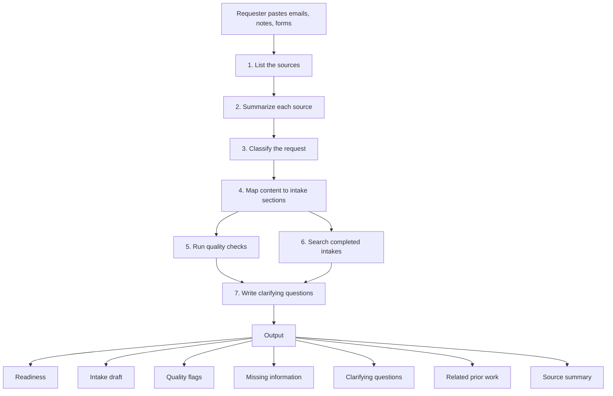

# How it works

The agent follows seven steps every time it runs. Each step has one job, so you can test and adjust them separately.



## Accepted inputs

The agent works with whatever the requester pastes or attaches:

- email threads
- meeting notes or transcripts
- call summaries
- request forms
- spreadsheets, pasted as text or attached where the platform supports files
- bullet points
- screenshots, where the platform supports images

Nothing has to be cleaned up first. The agent drafts what the material supports and asks for what is missing.

## The steps

**1. List the sources.** The agent names every item it received. Reviewers can see at a glance whether something the requester attached was skipped.

**2. Summarize each source.** Three to six bullets per email or note. This becomes the communication summary that analysts read first.

**3. Classify the request.** The agent picks one type from `config/request-types.yaml`, such as a new capability, a change to something that exists, a defect, or a compliance-driven change. It tags the type `[SOURCE]` or `[INFERRED]` and gives a one-line reason. Each type names the sections and topics that deserve a closer look. A retirement, for example, points the agent at downstream systems and dependencies. If two types fit, the agent names both and says which is primary.

**4. Map content to sections.** The agent fills each section in `config/intake-sections.yaml` and tags every entry:

| Tag | Meaning |
| --- | --- |
| `[SOURCE]` | Stated in the material provided |
| `[INFERRED]` | A reading of the material, with the line it came from |
| `[PRIOR]` | Suggested by a linked completed intake |
| `[MISSING]` | Not found; a question is raised instead |
| `[CONFLICT]` | Sources disagree; both versions are shown |

Tags let analysts trust the draft without rereading every email. They also make errors easy to trace during testing.

**5. Run quality checks.** The agent tests its draft against `config/quality-checks.yaml`: vague actions, unnamed systems, missing dates, testing with no owner, solutions with no stated outcome, and more. Blockers come first.

**6. Search completed intakes.** The agent searches wherever your platform indexes completed intakes, returns the closest matches, and points out details those intakes recorded that this one lacks. It also flags possible duplicates.

**7. Write clarifying questions.** Using `config/clarifying-topics.yaml`, the agent writes the questions an analyst would ask before requirements start, grouped by topic and marked for an internal or external answer.

## The output

The response has seven parts, always in this order:

1. **Readiness**: one line with a verdict, the request type, and counts.
2. **Intake draft**: every section, tagged, ready to paste.
3. **Quality flags**: a table of failed checks, blockers first.
4. **Missing information**: numbered questions for the requester.
5. **Clarifying questions**: grouped by topic, marked internal or external.
6. **Related prior work**: matching completed intakes, with links.
7. **Source summary**: the source list and the summaries from Step 2.

The Readiness line comes first so a reader knows the state of the request before reading the details:

```text
Readiness: Blocked. Type: Change to existing (inferred). 9 of 15 sections ready, 6 need answers, 2 blockers.
```

| Verdict | When |
| --- | --- |
| `Ready to submit` | No blocker flags, and no required section marked `[MISSING]` |
| `Needs answers` | No blocker flags, and one or more required sections marked `[MISSING]` |
| `Blocked` | One or more blocker flags |

A section counts as ready when it has no `[MISSING]` or `[CONFLICT]` entry. Every other section needs answers.

The response ends with one line: "Review the checklist before you submit." The checklist is in [review-checklist.md](review-checklist.md).

## Design decisions

**No invented facts.** A blank field with a question is more useful than a confident wrong answer. The instructions forbid filling gaps with plausible guesses, and the evaluation method treats any invented fact as a failed case.

**Configuration outside the instructions.** Your sections, checks, request types, and system names live in YAML files. The instruction logic stays the same for every team, so improvements to the logic carry over without touching your configuration.

**Copy and paste output.** Most intake tools do not accept writes from an assistant. The draft is formatted section by section so the requester can paste it in. Direct submission is a later integration, once the output has earned trust.

**Pasted text is data.** Emails sometimes contain text that reads like an instruction. The agent treats everything pasted as content to summarize, never as a command. The evaluation set includes a case that tests this: see [evals/cases](../evals/cases/README.md).

## Where people stay in the loop

The agent drafts and asks. People confirm and submit. Before submitting, the requester works through the [review checklist](review-checklist.md): check every inferred entry, resolve every conflict, send the blocker questions, and keep personal data out.

## Limits

- The related-work step depends on completed intakes being indexed by your platform and visible to the person running the agent.
- The agent cannot confirm facts with people. It can only ask the questions.
- A person reviews every draft before submission.
