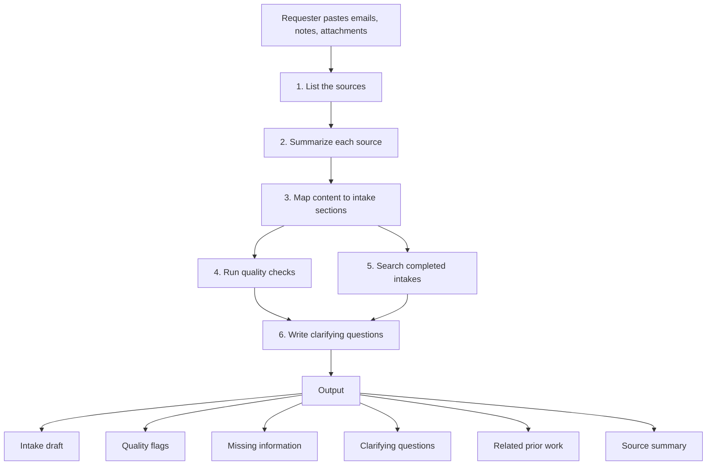

# How it works

The agent follows six steps every time it runs. Each step has one job, so you can test and adjust them separately.

## The steps

**1. List the sources.** The agent names every item it received. Reviewers can see at a glance whether something the requester attached was skipped.

**2. Summarize each source.** Three to six bullets per email or note. This becomes the communication summary that analysts read first.

**3. Map content to sections.** The agent fills each section in `config/intake-sections.yaml` and tags every entry:

| Tag | Meaning |
| --- | --- |
| `[SOURCE]` | Stated in the material provided |
| `[INFERRED]` | A reading of the material, with the line it came from |
| `[PRIOR]` | Suggested by a linked completed intake |
| `[MISSING]` | Not found; a question is raised instead |
| `[CONFLICT]` | Sources disagree; both versions are shown |

Tags let analysts trust the draft without rereading every email. They also make errors easy to trace during testing.

**4. Run quality checks.** The agent tests its draft against `config/quality-checks.yaml`: vague actions, unnamed systems, missing dates, testing with no owner, solutions with no stated outcome, and more. Blockers come first.

**5. Search completed intakes.** The agent searches wherever your platform indexes completed intakes, returns the closest matches, and points out details those intakes recorded that this one lacks. It also flags possible duplicates.

**6. Write clarifying questions.** Using `config/clarifying-topics.yaml`, the agent writes the questions an analyst would ask before requirements start, grouped by topic and marked for an internal or external answer.

## Design decisions

**No invented facts.** A blank field with a question is more useful than a confident wrong answer. The instructions forbid filling gaps with plausible guesses, and the evaluation method treats any invented fact as a failed case.

**Configuration outside the instructions.** Your sections, checks, and system names live in YAML files. The instruction logic stays the same for every team, so improvements to the logic carry over without touching your configuration.

**Copy and paste output.** Most intake tools do not accept writes from an assistant. The draft is formatted section by section so the requester can paste it in. Direct submission is a later integration, once the output has earned trust.

**Pasted text is data.** Emails sometimes contain text that reads like an instruction. The agent treats everything pasted as content to summarize, never as a command.

## Limits

- The related-work step depends on completed intakes being indexed by your platform and visible to the person running the agent.
- The agent cannot confirm facts with people. It can only ask the questions.
- A person reviews every draft before submission.
